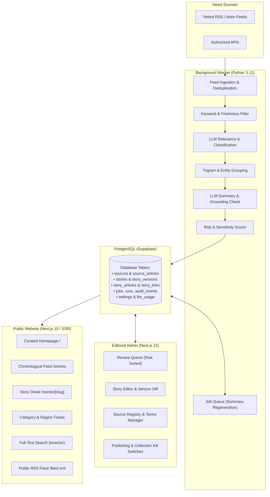

# Salfra: High-Level Project Overview

**Executive Summary and Product Architecture**  
*Platform:* Salfra AI News Curator  
*Repository Root:* [Workspace Root](file:///m:/CODES/Extra/Salfra)  
*Document Category:* Project Overview & Product Vision  
*Target Audience:* Stakeholders, Engineering Leads, Product Managers, Editorial Team  

---

## 1. Executive Summary

**Salfra** is an automated, AI-assisted news curation and intelligence platform focused exclusively on **Artificial Intelligence (AI)** and **Modern Technology**. The platform continuously discovers, screens, consolidates, and summarizes credible news articles from approved primary and secondary technology publications, official research laboratories, government cybersecurity agencies, and African technology newsrooms.

Rather than acting as an unconstrained web scraper or a generic AI headline generator, Salfra operates as a **disciplined editorial pipeline**. It adheres to three core tenets:
1. **Source Grounding & Factuality**: Every factual assertion, quotation, and number in a published summary must be strictly verified against retrieved source text. Hallucinated facts, invented numbers, and unsupported claims are rejected by automated validators.
2. **Consolidated Event Reporting**: Multiple publishers reporting on the same underlying product release, research paper, or cybersecurity advisory are grouped into a single cohesive story with full attribution to all reporting outlets.
3. **Regional Visibility**: Groundbreaking technology developments across Ghana and the broader African continent are elevated alongside global tech news in a unified, un-siloed reader feed.

The system pairs an automated **Python background worker** (running on a scheduled two-hour cycle) with a **Next.js 15 web application** backed by a shared **PostgreSQL database**. Crucially, the platform enforces **human-in-the-loop review** by default: stories flagged with high risk, single sources, or sensitive subjects cannot be published without manual editorial sign-off.

---

## 2. Problem Statement & Solution

```
┌─────────────────────────────────────────────────────────────────────────────┐
│                            THE PROBLEM                                      │
├─────────────────────────────────────────────────────────────────────────────┤
│ • Information Overload: Hundreds of feeds, blogs, and press releases daily. │
│ • Clickbait & Hallucination: Sensationalized headlines and AI fabrications. │
│ • Fragmented Coverage: Dozens of articles repeating the exact same release. │
│ • Western Bias: African and Ghanaian tech innovations frequently ignored.   │
└──────────────────────────────────────┬──────────────────────────────────────┘
                                       │
                                       ▼
┌─────────────────────────────────────────────────────────────────────────────┐
│                           THE SALFRA SOLUTION                               │
├─────────────────────────────────────────────────────────────────────────────┤
│ • Strict Source Registry: Only verified RSS/Atom feeds from vetted outlets. │
│ • Factual Grounding Guardrails: Regex and substring validation of quotes.   │
│ • Intelligent Deduplication: Trigram & entity-based candidate grouping.     │
│ • Unified Pan-African & Global Feed: Equal prominence for African tech.     │
│ • Editorial Integrity: Full attribution, audit log, and public corrections. │
└─────────────────────────────────────────────────────────────────────────────┘
```

---

## 3. Core Objectives

| # | Objective | Implementation Mechanism |
|---|---|---|
| **1** | **Automated 2-Hour Discovery** | Scheduled background worker inspecting verified feeds using HTTP conditional headers (`ETag`, `If-Modified-Since`). |
| **2** | **Zero-Tolerance Hallucination** | Dual-pass grounding validator checking that all numbers, quotes (≤25 words), and claims exist verbatim in source text. |
| **3** | **Story Consolidation** | Entity extraction and trigram similarity (`pg_trgm`) matching related articles into unified stories with role classification. |
| **4** | **Uncompromising Attribution** | Compulsory links to original source URLs; database constraints forbid publishing any story without at least one source link. |
| **5** | **African Tech Visibility** | Dedicated region hints (`ghana`, `africa`, `global`) and automatic categorization for African technology milestones. |
| **6** | **Editorial Oversight & Safety** | Administrative review dashboard with risk-based sorting, sensitive topic detection, and emergency kill switches. |
| **7** | **Zero-Spend Operational Model** | Built with free/low-tier services: GitHub Actions, PostgreSQL on Supabase, and lightweight LLM API usage. |

---

## 4. High-Level System Architecture

Salfra is organized as a **modular monolith** with clear boundary separation. The public website never performs background collection or LLM inference; it communicates strictly through the database.



### Component Roles & Responsibilities

1. **News Collection & Ingestion ([`worker/app/ingest.py`](file:///m:/CODES/Extra/Salfra/worker/app/ingest.py))**:
   - Queries enabled sources from the `sources` table.
   - Fetches XML/RSS feeds while enforcing polite headers, caching (`ETag`, `Last-Modified`), and domain rate limits.
   - Normalizes URLs (stripping tracking query params like `utm_*`, `fbclid`) and creates SHA-256 content hashes to guarantee idempotency.
2. **AI Processing Pipeline ([`worker/app/pipeline.py`](file:///m:/CODES/Extra/Salfra/worker/app/pipeline.py))**:
   - Executes cheap rule-based prefiltering (dropping listicles, deals, promos, and stale articles).
   - Prompts the LLM with structured Pydantic schemas to assess tech/AI relevance, categorize the story, and identify named entities.
   - Matches incoming reports with existing stories in a 5-day window using PostgreSQL trigram similarity and entity overlap.
   - Generates concise summaries and extracts verbatim quotes backing every factual assertion.
   - Validates numbers, quotes, and claims against raw text before advancing the story to the review queue.
3. **Database & State Machine ([`db/migrations/001_schema.sql`](file:///m:/CODES/Extra/Salfra/db/migrations/001_schema.sql))**:
   - Manages relational state transitions (`discovered` → `held` / `quarantined` / `grouped`; `draft` → `awaiting_review` → `approved` → `published`).
   - Enforces business rules at the database engine level using PostgreSQL triggers (e.g., blocking publication if the kill switch is active, if source links are absent, or if headlines/summaries are empty).
4. **Editorial Admin Panel ([`web/src/app/admin`](file:///m:/CODES/Extra/Salfra/web/src/app/admin))**:
   - Secured behind Supabase Authentication and mandatory Multi-Factor Authentication (MFA/TOTP).
   - Allows human editors to review candidate stories, compare summaries with source evidence, approve, reject, merge duplicate coverage, split misgrouped reports, or issue public correction notices.
5. **Public Web Portal ([`web/src/app`](file:///m:/CODES/Extra/Salfra/web/src/app))**:
   - Server-Side Rendered (SSR) with Next.js 15 for fast response times, accessible markup, and search-engine optimization.
   - Provides full-text search with PostgreSQL `tsvector` and `websearch_to_tsquery`.
   - Offers dedicated views for categories (*AI News*, *Global Tech*, *Product Releases*, *African Tech*), regions (*Ghana*, *Africa*), and an RSS feed (`/feed.xml`).

---

## 5. Key Personas & User Journeys

### Persona 1: The Technology Enthusiast / Developer
- **Goal**: Quickly understand what happened in AI and software engineering today without reading 30 duplicate blog posts or hype-filled press releases.
- **Journey**:
  1. Lands on the homepage (`/`) or chronological feed (`/stories`).
  2. Scans story cards showing headlines, 2–3 sentence summaries, and evidence labels (e.g., *"Primary source available"*).
  3. Clicks into a story to read structured breakdowns (*What happened*, *Why it matters*, *What remains uncertain*).
  4. Follows primary links directly to original research papers or official company blogs.

### Persona 2: The African Tech Professional / Entrepreneur
- **Goal**: Track venture deals, policy shifts, infrastructure projects, and AI adoption across Ghana, Nigeria, Kenya, South Africa, and the wider continent.
- **Journey**:
  1. Navigates to `/category/african-tech` or `/region/ghana`.
  2. Finds consolidated reporting on African tech companies alongside global developments.
  3. Filters by publisher (e.g., *Techpoint Africa*, *TechCabal*) or date ranges.

### Persona 3: The Editorial Administrator
- **Goal**: Ensure editorial quality, resolve ambiguous event groupings, handle copyright/terms requests, and maintain platform integrity.
- **Journey**:
  1. Logs in via `/admin/login` and completes TOTP 2FA at `/admin/mfa`.
  2. Opens the `/admin/review` queue, prioritized by risk score and pending source changes.
  3. Inspects side-by-side evidence: the AI summary, extracted verbatim quotes, and original publisher text.
  4. Approves the story for publishing, edits copy, or merges duplicate coverage.

---

## 6. Editorial Standards & Responsible AI Principles

Salfra distinguishes itself through conservative, transparent editorial mechanics:

* **Attribution First**: Salfra is an indexing and curation tool, not an original publisher. Every story must link directly to the source articles from which its facts originate.
* **Verifiable Evidence Labels**: Every story receives an evidence rating:
  - `primary_source_available`: Backed by an official announcement, whitepaper, or repo.
  - `multiple_publishers`: Covered by multiple distinct publishers.
  - `single_source`: Currently reliant on one outlet; flagged for cautious reading.
  - `reports_differ`: Sources report conflicting figures or timelines; explicitly noted in the UI.
  - `verification_incomplete`: Limited metadata accessible; presented as a brief stub.
* **Versioned Corrections**: Once a story is published, it cannot be quietly rewritten. Any material change creates a new version (`story_versions`), appends a public note (`story_corrections`), and displays an "Updated" badge in the feed.
* **Transient Text Processing**: Full-text article bodies are never persisted permanently in the database unless explicitly authorized. Only short excerpts, metadata, and grounded claims are retained, protecting against copyright infringement.
* **Prompt Injection Resilience**: Incoming text from external RSS feeds is treated as untrusted data. Prompts enclose raw content between randomized boundary tokens (`<<<UNTRUSTED_xxxx>>>`) and instruct the LLM to ignore embedded commands.

---

## 7. Technology Stack Summary

| Layer | Technology | Primary Function |
|---|---|---|
| **Frontend Framework** | [Next.js 15.5](file:///m:/CODES/Extra/Salfra/web/package.json) (React 19) | Server-Side Rendering, Server Actions, Route Handlers |
| **Styling & UI** | Vanilla CSS (`globals.css`) | Semantic HTML, accessible design, high contrast |
| **Backend Worker** | [Python 3.12](file:///m:/CODES/Extra/Salfra/worker/requirements.txt) | Ingestion, text parsing, LLM orchestration, evaluation |
| **Database** | [PostgreSQL 17](file:///m:/CODES/Extra/Salfra/db/migrations/001_schema.sql) (via Supabase) | Relational storage, RLS, triggers, full-text search, trigrams |
| **Authentication** | Supabase Auth + TOTP MFA | Admin authentication, session management, role verification |
| **Database Drivers** | `postgres.js` (TypeScript) / `psycopg 3` (Python) | High-performance, parameterized SQL communication |
| **Text & Feed Extraction** | `feedparser`, `trafilatura` | RSS/Atom parsing, sanitized DOM extraction |
| **AI / LLM Integration** | OpenAI-compatible HTTP API (`httpx`, Pydantic) | Structured JSON extraction, relevance, grouping, summaries |
| **Scheduler & Automation** | GitHub Actions (`cron`) | 2-hour collection, 30-minute health monitoring, daily backups |
| **Testing & Evaluation** | `pytest`, custom JSONL offline eval | Unit tests, idempotency checks, precision/recall benchmarks |

---

## 8. Summary of Project Status

The Salfra codebase represents a fully structured, functional MVP implementation. The database migrations define a complete schema with enforced relational integrity; the Python worker contains complete modules for ingestion, deduplication, LLM interaction, and health monitoring; and the Next.js web application provides both a responsive public blog and an administrative review panel.

The subsequent documents in this directory provide deep-dive technical explorations:
- **[Detailed Comprehensive Report](file:///m:/CODES/Extra/Salfra/docs/detailed_comprehensive_report.md)**: Exhaustive breakdown of code paths, schemas, algorithms, and system mechanics.
- **[System Improvements and Audit](file:///m:/CODES/Extra/Salfra/docs/system_improvements_and_audit.md)**: In-depth code audit, KISS & YAGNI evaluation, bug inventory, and architectural upgrade roadmap.
